  

 

[Qué es](#qué-es) · [Funcionalidades](#funcionalidades) · [Cómo funciona](#cómo-funciona) · [Predicción](#predicción-de-demanda) · [Inicio rápido](#inicio-rápido) · [Documentación](#documentación)

## Qué es

Inventia centraliza el inventario de una empresa con varias sedes, registra cada movimiento con trazabilidad completa, avisa cuando algo requiere atención y usa los datos de ventas para estimar la demanda y recomendar qué reponer o qué trasladar entre sedes. Las recomendaciones las aprueba siempre una persona.

Es el proyecto de grado de Ingeniería de Sistemas. Los requisitos provienen del documento del proyecto (RF-001 a RF-038, RN-001 a RN-012, RNF-001 a RNF-050) y su correspondencia punto por punto está en [docs/TRAZABILIDAD.md](docs/TRAZABILIDAD.md).

## Funcionalidades

| Módulo | Qué hace |
| :-- | :-- |
| **Empresas y sedes** | Varias empresas aisladas entre sí, con sedes por empresa y parámetros configurables (plazos, cobertura, umbrales) |
| **Usuarios y permisos** | 5 roles de fábrica, roles personalizados, 61 permisos y alcance por sede |
| **Catálogo** | Categorías y productos con código inmutable, costo y precio |
| **Inventario** | Existencias por sede y consolidadas; entradas, salidas y ajustes con historial inmutable; mínimos y máximos |
| **Ventas** | Registro multiproducto con descuento atómico de existencias; anulación con motivo y reintegro |
| **Traslados** | Solicitud, aprobación de la sede de origen y confirmación de la sede de destino; las existencias se mueven solo al confirmar |
| **Alertas** | Inventario bajo, excesivo, riesgo de desabastecimiento y sin rotación; se abren y se cierran solas |
| **Predicción** | Pronóstico por sede y producto con 6 modelos comparados contra una línea base |
| **Recomendaciones** | Reabastecimiento y traslado explicados en español, con aprobación humana obligatoria |
| **Reportes** | Siete reportes con vista previa y exportación a PDF, Excel y CSV |
| **Auditoría** | Registro inmutable de accesos y operaciones |
| **Asistente** | Chat en español para consultar y comparar datos y explicar el sistema; motor por reglas, solo lectura y limitado por los permisos y la sede del rol |

## Cómo funciona

La interfaz es una aplicación de una sola página que nginx sirve y cuyas llamadas a /api reenvía a la API. La predicción corre dentro de la propia API como tarea en segundo plano y la interfaz consulta su estado.

~~~mermaid
flowchart LR
  U["Navegador React SPA"] --> N["nginx build estático y cabeceras de seguridad"]
  N -- "/api" --> A["FastAPI controller, service, model"]
  A --> D[("PostgreSQL 16")]
  A -. "tarea en segundo plano" .-> M["Módulo de predicción numpy, scikit-learn, statsmodels"]
  M --> D
~~~

Un traslado entre sedes pasa por tres pasos y solo el último toca las existencias:

~~~mermaid
flowchart LR
  S["Solicitud sede que necesita"] --> P["Aprobación sede de origen"] --> C["Confirmación sede de destino"] --> E["Las existencias se mueven"]
~~~

### Garantías de diseño

| Garantía | Cómo se logra |
| :-- | :-- |
| Sin sobreventa por concurrencia | La condición cantidad + delta >= 0 va dentro del propio UPDATE y los bloqueos se toman siempre en el mismo orden (sede, producto) |
| Operaciones atómicas | Un servicio equivale a una transacción; los errores de negocio son excepciones tipadas con un único manejador JSON |
| Consecutivos consistentes | Se generan con una tabla de secuencias de forma atómica |
| Traslados sin doble confirmación | La confirmación es un UPDATE que solo puede tener éxito una vez |
| Historial inmutable | Movimientos y auditoría aceptan solo inserciones, impuesto por un trigger de PostgreSQL |
| Fechas consistentes | Se guardan en UTC y el día de la venta se calcula en la zona horaria de la empresa |
| Contrato API e interfaz | Los tipos del frontend se generan desde OpenAPI y la integración continua falla si quedan desactualizados |

## Predicción de demanda

Para cada producto y sede se comparan 6 modelos contra una línea base con validación temporal. El error se mide con WAPE, MAE, RMSE y MAPE, y cada pronóstico trae un intervalo del 80 % y un nivel de confianza. Lo que no tiene datos suficientes se omite y se explica el motivo.

La predicción se validó con datos sintéticos de demostración y debe medirse con las ventas reales de cada empresa antes de apoyarse en ella. Detalle en [docs/PREDICCION.md](docs/PREDICCION.md).

## Tecnologías

  

 

| Capa | Tecnología |
| :-- | :-- |
| Backend | Python 3.13 · FastAPI · SQLAlchemy 2 asíncrono · Alembic · pydantic v2 · Argon2 · JWT |
| Predicción | numpy · scikit-learn · statsmodels |
| Frontend | React 19 · TypeScript estricto · Vite · Tailwind v4 · TanStack Query · React Hook Form + zod |
| Datos | PostgreSQL 16 (SQLite solo para pruebas rápidas) |
| Infraestructura | Docker · Docker Compose · nginx · GitHub Actions |

## Inicio rápido

### Con Docker Compose

~~~bash
cp infra/.env.example infra/.env   # complete POSTGRES_PASSWORD, SECRET_KEY y SETUP_TOKEN con valores propios
docker compose -f infra/docker-compose.yml --env-file infra/.env up -d --build
~~~

Abra http://localhost:8080: la pantalla de configuración inicial crea la empresa y su primer administrador (pide el SETUP_TOKEN). La configuración de Docker se validó solo en parte, así que haga una primera prueba en un entorno de ensayo; detalles y lista de comprobación de producción en [docs/DESPLIEGUE.md](docs/DESPLIEGUE.md).

### En su máquina

Requisitos: Python 3.13 (sirven 3.12 a 3.14), Node.js 22 y PostgreSQL 16.

~~~bash
npm install
npm run setup    # entorno virtual, dependencias y backend/.env
# edite backend/.env: DATABASE_URL y SECRET_KEY
npm run migrar
npm run demo     # opcional: empresa ficticia de movilidad eléctrica con 4 meses de ventas
npm run dev      # interfaz en :5173, API en :8000
~~~

Paso a paso y solución de problemas en [docs/DESARROLLO.md](docs/DESARROLLO.md).

### Primer administrador

No existe registro público. El primer administrador se crea una sola vez con el token de configuración, desde la pantalla inicial o con la línea de comandos:

~~~bash
cd backend && python -m app.cli inicializar --empresa "Mi Empresa" --admin-nombre "Nombre Apellido" --admin-correo admin@empresa.example
~~~

La contraseña se pide por consola sin eco o se lee de INVENTIA_ADMIN_PASSWORD; nunca se pasa por argumentos.

## Estructura

~~~text
.
├── backend/    API, migraciones y pruebas
│   └── app/    controller, dto, service, specification, mapper, model,
│               security, exception, config, util, ml
├── frontend/   Interfaz web
├── ml/         Experimento reproducible de evaluación de modelos
├── infra/      Docker Compose y scripts de respaldo y restauración
├── scripts/    Utilidades multiplataforma para npm run
└── docs/       Documentación
~~~

Las carpetas del backend siguen la organización por capas de un proyecto Spring; [docs/GUIA_ESTRUCTURA.md](docs/GUIA_ESTRUCTURA.md) explica qué hay en cada una y cómo viaja una petición.

## Pruebas

~~~bash
npm test                                    # backend (SQLite) y frontend
npm run lint && npm run typecheck && npm run build
~~~

Las pruebas que dependen de PostgreSQL (concurrencia, migraciones, disparadores) se ejecutan definiendo TEST_DATABASE_URL con una base descartable. Lo verificado y lo que no, en [docs/LIMITACIONES.md](docs/LIMITACIONES.md).

## Documentación

Ver los 13 documentos

 

| Documento | Para qué |
| :-- | :-- |
| [MANUAL_USUARIO](docs/MANUAL_USUARIO.md) | Uso diario, por tareas y por rol |
| [ARQUITECTURA](docs/ARQUITECTURA.md) | Capas, aislamiento, integridad del inventario y diagramas |
| [GUIA_ESTRUCTURA](docs/GUIA_ESTRUCTURA.md) | Dónde está cada cosa en el backend y recorrido de una petición |
| [MODELO_DATOS](docs/MODELO_DATOS.md) | Tablas, restricciones, índices e invariantes |
| [PREDICCION](docs/PREDICCION.md) | Cómo se estima la demanda, se mide el error y se generan recomendaciones |
| [SEGURIDAD](docs/SEGURIDAD.md) | Controles implementados y responsabilidades de quien despliega |
| [API](docs/API.md) | Convenciones y mapa de rutas |
| [DESARROLLO](docs/DESARROLLO.md) | Entorno, pruebas, migraciones y convenciones |
| [DESPLIEGUE](docs/DESPLIEGUE.md) | Docker, producción, respaldos y actualizaciones |
| [DECISIONES](docs/DECISIONES.md) | Decisiones de diseño y diferencias con el documento de grado |
| [TRAZABILIDAD](docs/TRAZABILIDAD.md) | Matriz RF, RN y RNF hacia implementación y prueba |
| [LIMITACIONES](docs/LIMITACIONES.md) | Qué está probado, qué no y qué falta |
| [CHANGELOG](CHANGELOG.md) | Registro de cambios |

## Seguridad y estado

El repositorio no contiene contraseñas ni claves: los archivos .env están excluidos y se usan los .env.example. Genere sus propios SECRET_KEY, SETUP_TOKEN y contraseña de base de datos, y rótelos si alguna vez los compartió. La aplicación no termina HTTPS, así que en producción debe publicarse detrás de un proxy con certificado. Controles y responsabilidades en [docs/SEGURIDAD.md](docs/SEGURIDAD.md).

Versión 1.2.0, Línea Base 1: sin el Sistema Integrado de Gestión ni los agentes de IA, y con las reglas del modelo entidad-relación garantizadas por la base de datos. Backend y frontend completos y probados; el detalle de lo verificado y lo pendiente está en [docs/LIMITACIONES.md](docs/LIMITACIONES.md).
