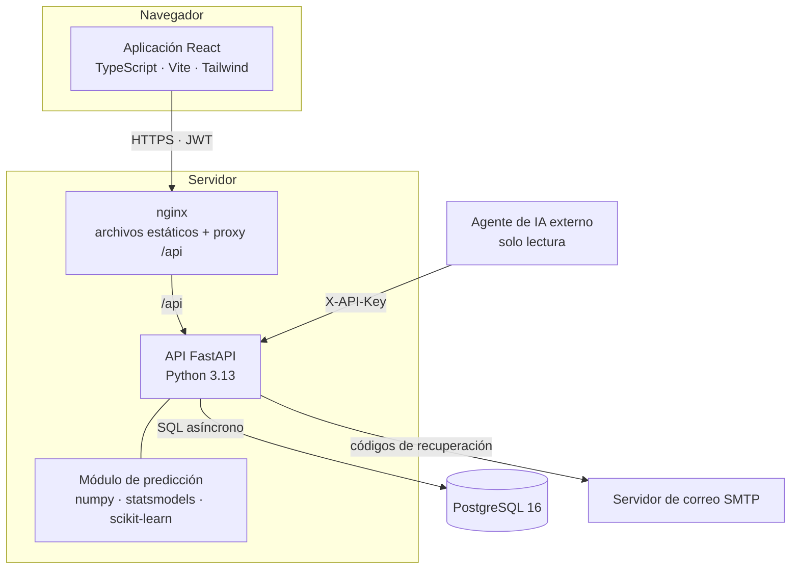
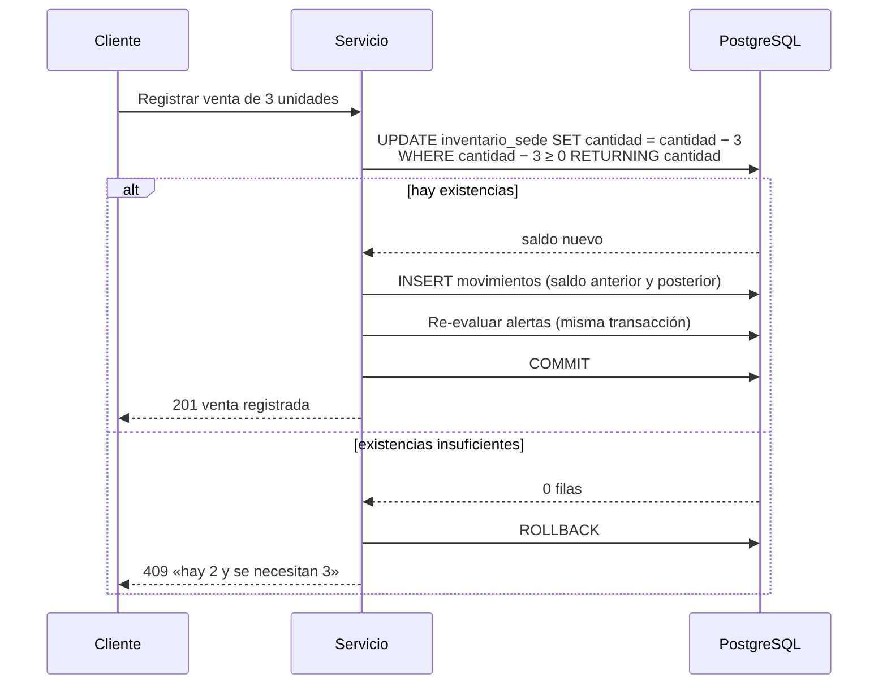
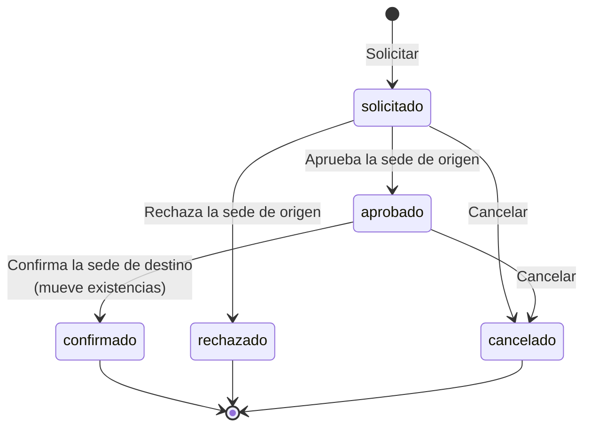
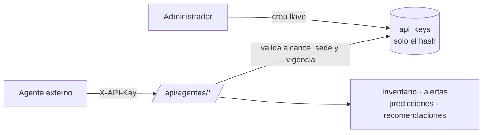
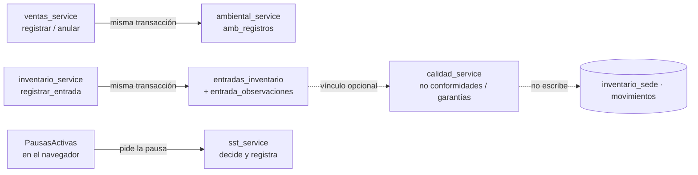
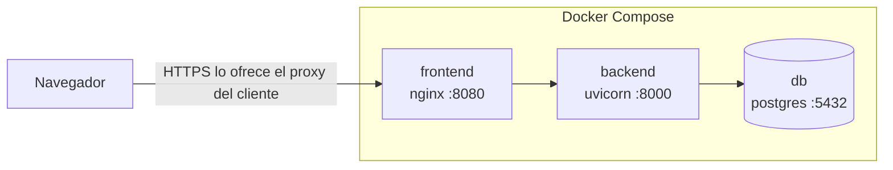

# Arquitectura

Inventia es una aplicación web de tres capas (interfaz, API y base de datos) más un módulo de predicción
que corre dentro de la API. Está pensada para una PyME con una o varias sedes y una sola base de datos central.

## Vista general



| Pieza | Tecnología | Responsabilidad |
|---|---|---|
| Interfaz | React 19, TypeScript estricto, Vite, Tailwind v4, TanStack Query, React Hook Form + zod | Presentación, validación en el cliente, ocultar lo que el usuario no puede usar |
| Servidor web | nginx (imagen sin privilegios) | Servir la aplicación compilada, reenviar `/api`, cabeceras de seguridad |
| API | FastAPI, SQLAlchemy 2 asíncrono, Alembic, pydantic v2 | Reglas de negocio, permisos, transacciones, auditoría |
| Predicción | numpy, statsmodels, scikit-learn (pandas y SciPy se instalan porque las exige statsmodels) | Pronóstico de demanda y evaluación (sin acceso a la base de datos) |
| Base de datos | PostgreSQL 16 | Única fuente de verdad; restricciones, índices y disparadores de solo inserción |

## Capas del backend

La API usa la estructura por capas de los proyectos Spring (`controller` → `service` → `model`), con los mismos nombres de
carpeta. La guía con las equivalencias y el recorrido de una petición está en [GUIA_ESTRUCTURA.md](GUIA_ESTRUCTURA.md).

```
backend/app/
├── controller/     Rutas HTTP: validan entrada, exigen permisos y delegan. Sin reglas de negocio.
├── dto/            Esquemas pydantic de entrada y salida (generan el contrato OpenAPI).
├── service/        Reglas de negocio y transacciones. Reciben un Contexto, nunca ids de empresa del cliente.
├── specification/  Filtros dinámicos de consulta: arman la lista de condiciones SQL según los parámetros recibidos.
├── mapper/         Conversión de entidades (model) a DTO de salida.
├── model/          Tablas SQLAlchemy (entidades).
├── security/       JWT, Argon2, permisos, contexto de la petición y dependencias que exigen permiso.
├── exception/      Excepciones de negocio (excepciones.py) y su traducción a JSON (manejadores.py).
├── config/         Configuración por variables de entorno, base de datos y registro de eventos.
├── util/           Utilidades pequeñas: fechas y zona horaria, niveles de stock, SQL.
├── ml/             Cálculo de predicción puro (sin base de datos): modelos, evaluación, pipeline, extracción.
├── cli.py          Administración desde la terminal (inicializar, predecir, cargar-demo, cargar-demo-sig, sincronizar-permisos).
├── demo.py         Datos de demostración generados a través de los mismos servicios que usa la API.
└── demo_sig.py     Datos de demostración del SIG (PQRS, calidad, pausas, ambiental), también a través de los servicios.
```

No hay carpeta `repository`: las consultas a la base de datos están dentro de cada servicio (decisión
[D-39](DECISIONES.md#d-39)).

Reglas que se mantienen en todo el código:

- **Los controladores no contienen reglas de negocio.** Un controlador valida, exige permiso y llama a un servicio.
- **El contexto manda.** Cada servicio recibe un `Contexto` (usuario, empresa, permisos, sedes autorizadas).
  Ninguna consulta confía en una empresa o sede enviada por el navegador sin comprobarla contra el contexto.
- **Un servicio, una transacción.** Cada operación confirma (`commit`) una sola vez al final; si algo falla, no
  queda nada a medias.
- **Los errores de negocio son excepciones tipadas** (`ReglaNegocio`, `Conflicto`, `SinPermiso`,
  `ExistenciasInsuficientes`…) que un único manejador convierte en la respuesta JSON uniforme.

## Aislamiento de empresas y sedes

```mermaid
flowchart LR
    T[Token JWT] --> U[Usuario + rol + permisos]
    U --> C[Contexto]
    C -->|empresa_id| F1[Todas las consultas<br/>filtran por empresa]
    C -->|sedes_autorizadas| F2[Rol de sede: solo su sede<br/>Rol de empresa: todas]
    C -->|permisos| F3[requiere&#40;permiso&#41;<br/>en cada ruta]
```



- **Multiempresa:** todas las tablas de negocio llevan `empresa_id` y todas las consultas lo filtran con el valor
  del contexto. Hay pruebas que crean dos empresas y verifican que ninguna ve ni modifica datos de la otra.
- **Multisede:** un rol con alcance `sede` queda restringido a la sede que tiene asignada; un rol con alcance
  `empresa` ve todas. El filtro se aplica en el servidor, no en la interfaz.
- **Permisos:** 61 permisos agrupados por módulo. Cada ruta declara cuáles acepta (`requiere(a, b)` = «alguno de»).

## Integridad del inventario

La cantidad disponible vive **únicamente** en `inventario_sede`. El consolidado es una suma de esas filas.



- La condición `cantidad + delta ≥ 0` está **dentro** del `UPDATE`, así que dos ventas simultáneas nunca dejan el
  stock negativo, sin necesidad de bloquear filas manualmente.
- Cuando una operación toca varias filas (venta con varios productos, traslado), se aplican siempre en el mismo
  orden (sede, producto) para evitar interbloqueos.
- Los consecutivos (número de venta y de traslado) salen de la tabla `secuencias` con una actualización atómica.
- La confirmación de un traslado es una «llave»: el `UPDATE` que pasa el estado de `aprobado` a `confirmado` solo
  tiene éxito una vez; si dos personas confirman a la vez, una de ellas recibe un conflicto y no se mueve nada.
- `movimientos` y `auditoria` son de **solo inserción**: un disparador de PostgreSQL rechaza `UPDATE` y `DELETE`
  incluso si alguien ejecuta SQL a mano. Los errores se corrigen con un movimiento compensatorio. Lo mismo ocurre con
  los historiales del SIG (`pqrs_historial`, `no_conformidad_historial`, `garantia_historial`) y con
  `entrada_observaciones`.
- Todas las fechas se guardan en UTC; el «día» de una venta se calcula en la zona horaria de la empresa.

## Ciclo de un traslado



Las existencias solo cambian al **confirmar**, en una sola transacción que descuenta del origen y suma al destino.

## Predicción y recomendaciones

Ver [PREDICCION.md](PREDICCION.md). En términos de arquitectura:

- `app/ml/` no importa SQLAlchemy ni FastAPI (salvo `datos.py`, que es la única pieza que lee la base de datos).
  Eso permite probar los modelos con series construidas a mano y reutilizarlos desde scripts (`ml/`).
- La ejecución corre como tarea en segundo plano de FastAPI. La interfaz sondea el estado.
- Las recomendaciones solo leen predicciones y existencias; **no escriben inventario**.

## Integración con agentes de IA



Las llaves son independientes de los usuarios, de **solo lectura**, con alcances (`inventario:leer`,
`alertas:leer`, `predicciones:leer`, `recomendaciones:leer`), vencimiento (90 días por defecto; la interfaz permite
entre 30 y 730), restricción opcional a una sede y revocación inmediata. Una llave no sirve en la API normal y un token de usuario no sirve en `/api/agentes`.

## Frontend

```
frontend/src/
├── App.tsx            Rutas, cada una protegida por permiso
├── auth/              Sesión, rutas protegidas, rutas públicas
├── components/
│   ├── ui/            Biblioteca interna (botones, tablas, modales, confirmaciones, avisos…)
│   ├── charts/        Gráficos en SVG hechos a mano (líneas, barras) sin librerías externas
│   └── layout/        Estructura de la aplicación y navegación filtrada por permisos
├── features/          Una carpeta por módulo (inventario, ventas, traslados, prediccion, …)
├── hooks/             useFiltros (estado en la URL), useMutacion, catálogos compartidos
├── lib/               Cliente HTTP, errores, formato (es-CO), permisos, formularios
└── types/api.gen.ts   Tipos generados del esquema OpenAPI (npm run tipos)
```

Decisiones de interfaz que conviene conocer:

- **Los tipos vienen de la API.** `npm run tipos` los regenera desde el esquema OpenAPI; la integración continua
  falla si quedaron desactualizados. Así un cambio en el backend que rompe la interfaz se detecta al compilar.
- **Los filtros viven en la URL.** Se puede compartir un enlace con la lista ya filtrada y el botón «atrás»
  funciona como se espera.
- **Cada pantalla resuelve cuatro estados:** cargando (esqueletos con la forma final), vacío (con indicación de
  qué hacer), error (con reintento) y contenido.
- **Sin dependencias externas en tiempo de ejecución:** fuentes e iconos van empaquetados; la política de seguridad
  de contenido solo permite recursos del mismo origen.
- **Carga diferida por ruta:** cada pantalla se descarga cuando se visita por primera vez.

## Sistema Integrado de Gestión (SIG)

El SIG reutiliza las mismas capas, el mismo contexto de petición y los mismos componentes de interfaz; no agrega
dependencias ni servicios. Se publica bajo `/api/sig/*` y en el grupo **SIG** del menú (ver D-28 a D-33 en
[DECISIONES.md](DECISIONES.md)).

| Apartado | Servicios | Cómo se conecta con lo existente |
|---|---|---|
| PQRS y sugerencias | `pqrs_service`, `adjuntos_service` | Usa los usuarios, las sedes y los consecutivos por empresa (`secuencias`); cada cambio queda en `auditoria` y en `pqrs_historial` |
| Seguridad y Salud en el Trabajo | `sst_service` | El servidor decide cuándo toca una pausa; la interfaz (`PausasActivas`) la pide y la muestra. Excluye a quien tenga `sst.gestionar` |
| Calidad | `calidad_service`, `entradas_service` | Las no conformidades y garantías apuntan a productos, entradas, ventas y sedes, pero **nunca escriben en `inventario_sede` ni en `movimientos`** |
| Gestión ambiental | `ambiental_service` | `ventas_service` lo invoca dentro de la transacción al registrar y al anular una venta; el índice único por línea de venta evita contarla dos veces |



Dos puntos de integración con el código anterior conviene conocerlos: `inventario_service.registrar_entrada` ahora crea la
cabecera de la entrada y enlaza sus movimientos, y `ventas_service` llama a `ambiental_service` al registrar y al anular
una venta. El resto del SIG no toca los módulos existentes.

## Despliegue



Al iniciar, el contenedor del backend aplica las migraciones pendientes (`alembic upgrade head`) y, si fallan, no
sirve tráfico. Ver [DESPLIEGUE.md](DESPLIEGUE.md) para el procedimiento y la lista de comprobación de producción.
La configuración de Docker se validó solo en parte (ver [DESPLIEGUE.md](DESPLIEGUE.md) y [LIMITACIONES.md](LIMITACIONES.md)).
