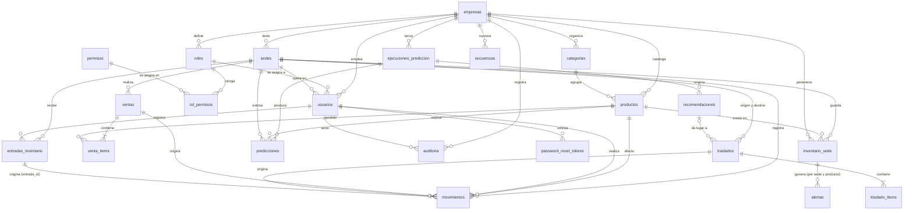

# Modelo de datos

Esquema de PostgreSQL gestionado con Alembic. Los nombres de índices y restricciones siguen una convención fija
(`ix_`, `uq_`, `ck_`, `fk_`, `pk_`), de modo que las migraciones son predecibles. Las columnas de estado se
guardan como texto (sin tipos `ENUM` nativos) para poder añadir valores sin migrar tipos.

## Diagrama

## Tablas

### Acceso y organización

| Tabla | Propósito | Reglas relevantes |
|---|---|---|
| `empresas` | Empresa cliente. `configuracion` (JSON) guarda los parámetros de inventario y predicción | `identificacion` única; inhabilitar la empresa bloquea el ingreso de todos sus usuarios |
| `sedes` | Ubicaciones de la empresa | Nombre único por empresa **sin distinguir mayúsculas** (`uq_sedes_empresa_nombre` sobre `lower(nombre)`) |
| `permisos` | Catálogo global de permisos (código, módulo, descripción) | Se define en `app/security/permisos.py` y se sincroniza al iniciar la API |
| `roles` | Roles por empresa. `clave` identifica los 5 del sistema; `alcance` es `empresa` o `sede` | Nombre único por empresa sin distinguir mayúsculas; clave única por empresa; los roles del sistema no se eliminan ni cambian de permisos |
| `rol_permisos` | Relación rol ↔ permiso | Clave compuesta; se borra en cascada con el rol |
| `usuarios` | Cuentas de acceso | `email` único global; `password_hash` (Argon2id); `password_version` invalida tokens; `intentos_fallidos` y `bloqueado_hasta` para el bloqueo temporal; `debe_cambiar_password` para contraseñas temporales |
| `password_reset_tokens` | Códigos de recuperación | El código y el token de sesión se guardan solo como hash; un solo uso; máx. 5 intentos; vencen |

### Catálogo e inventario

| Tabla | Propósito | Reglas relevantes |
|---|---|---|
| `categorias` | Agrupación de productos | Nombre único por empresa sin distinguir mayúsculas |
| `productos` | Catálogo | `(empresa_id, codigo)` único; el código no cambia; `costo` y `precio_venta` son datos distintos; `unidad_medida` |
| `inventario_sede` | **Única** fuente de existencias: cantidad por sede y producto, más `stock_minimo` y `stock_maximo` | `UNIQUE (sede_id, producto_id)`; `CHECK cantidad >= 0`; `CHECK stock_maximo >= stock_minimo` |
| `movimientos` | Historial inmutable de cada cambio de existencias | `CHECK delta <> 0` y `saldo_posterior >= 0`; guarda saldo anterior y posterior, usuario, sede contraparte (traslados) y la venta o traslado de origen; **solo inserción** (disparador) |
| `secuencias` | Consecutivos por empresa (`venta`, `traslado`) | Clave `(empresa_id, nombre)`; se incrementa de forma atómica |
| `alertas` | Alertas de inventario abiertas y resueltas | Índice único **parcial** `(sede_id, producto_id, tipo) WHERE estado = 'activa'`: nunca hay dos alertas activas iguales |

Tipos de movimiento: `entrada`, `salida`, `ajuste`, `venta`, `anulacion_venta`, `traslado_salida`, `traslado_entrada`.

### Ventas y traslados

| Tabla | Propósito | Reglas relevantes |
|---|---|---|
| `ventas` | Cabecera de venta | `(empresa_id, numero)` único; `fecha_dia` es el día local para agrupar; la venta anulada se conserva con quién, cuándo y por qué |
| `venta_items` | Líneas de venta | `cantidad > 0`; un producto una sola vez por venta; el precio queda congelado en la línea |
| `traslados` | Solicitud de traslado entre sedes | `CHECK sede_origen_id <> sede_destino_id`; guarda quién solicitó, aprobó, confirmó o cerró, y cuándo; `recomendacion_id` si nació de una recomendación |
| `traslado_items` | Líneas de traslado | `cantidad > 0`; un producto una sola vez por traslado |

### Predicción y recomendaciones

| Tabla | Propósito | Reglas relevantes |
|---|---|---|
| `ejecuciones_prediccion` | Una corrida del módulo predictivo | Estado, horizonte, fecha de corte, parámetros y un `resumen` con series evaluadas, omitidas (con motivos) y métricas globales |
| `predicciones` | Demanda estimada de un producto en una sede para un periodo | `(ejecucion_id, sede_id, producto_id)` único; guarda modelo, intervalo, confianza, métricas de validación, serie diaria y advertencias. Se borra en cascada con su ejecución |
| `recomendaciones` | Sugerencias de reabastecimiento o traslado | Estados: `pendiente`, `aprobada`, `rechazada`, `ejecutada`, `reemplazada`; guarda la `justificacion` (datos de origen) y quién la revisó |

### Entradas de mercancía

| Tabla | Propósito | Reglas relevantes |
|---|---|---|
| `entradas_inventario` | Cabecera de cada entrada de mercancía (sede, motivo, quién y cuándo) | `(empresa_id, numero)` único; los movimientos de tipo `entrada` apuntan a ella con `movimientos.entrada_id` (nulo en los movimientos anteriores a la versión 1.1). La entrada no se edita ni se borra; el detalle se consulta en solo lectura |

### Auditoría

| Tabla | Propósito | Reglas relevantes |
|---|---|---|
| `auditoria` | Accesos y operaciones relevantes | **Solo inserción** (disparador); guarda copia del correo del actor, IP, `request_id` y resultado; `detalle` nunca contiene secretos |

## Índices pensados para las consultas reales

| Índice | Consulta que acelera |
|---|---|
| `ix_movimientos_empresa_fecha` | Historial por periodo, reportes de movimientos |
| `ix_movimientos_sede_producto_fecha` | Historial de un producto en una sede, reconstrucción de saldos para la predicción |
| `ix_ventas_empresa_fecha_dia`, `ix_ventas_sede_fecha_dia` | Listados y reportes de ventas, series de demanda |
| `ix_alertas_empresa_estado` | Contador y lista de alertas activas |
| `ix_traslados_empresa_estado` | Traslados pendientes |
| `ix_recomendaciones_empresa_estado` | Recomendaciones pendientes |
| `ix_predicciones_empresa_serie` | Última predicción de un producto en una sede |
| `ix_auditoria_empresa_fecha`, `ix_auditoria_modulo_accion` | Consulta de auditoría con filtros |

Las tablas con mayor crecimiento (`movimientos`, `auditoria`, `alertas`, `predicciones`) usan `BIGINT` como llave
primaria en PostgreSQL.

## Invariantes que el sistema garantiza

Estas propiedades las verifica `test_invariantes_de_inventario_tras_operar` y las pruebas de concurrencia:

1. `inventario_sede.cantidad` nunca es negativa.
2. Para cada sede y producto, la suma de los `delta` de `movimientos` es igual a `inventario_sede.cantidad`
   (la migración 0003 crea un movimiento de «inventario inicial» por cada saldo existente para que esto se cumpla
   también con datos migrados).
3. El inventario consolidado es igual a la suma de las existencias de todas las sedes.
4. Un traslado confirmado produce exactamente un movimiento de salida y uno de entrada por producto, con la
   misma cantidad.
5. Una venta anulada devuelve exactamente lo que descontó, una sola vez.
6. No existen dos alertas activas iguales para la misma sede, producto y tipo.
7. No existen consecutivos repetidos de venta ni de traslado dentro de una empresa.
8. Toda alerta pertenece a una existencia por sede: no puede existir una alerta de un producto en una sede donde ese
   producto no tiene fila en `inventario_sede` (llave foránea compuesta, CRF-MER-01).
9. Una recomendación da lugar, como máximo, a un traslado (`traslados.recomendacion_id` único, CRF-MER-01).
10. Toda recomendación nace de una ejecución de predicción (`recomendaciones.ejecucion_id` obligatorio, CRF-MER-01).

## Migraciones

| Revisión | Contenido |
|---|---|
| `1951a4ae8cf0` | Modelos iniciales (versión anterior del proyecto) |
| `5cb4ddecc152` | Códigos de recuperación de 6 dígitos |
| `0003_inventia` | Reestructuración: RBAC con 5 roles, auditoría, catálogo, inventario por sede con movimientos, ventas, traslados, predicción, recomendaciones y llaves de agentes (retiradas en 1.2.0). **Conserva los datos** de la versión anterior |
| `0004_sig` | Sistema Integrado de Gestión (versión 1.1): tablas de entradas y observaciones, PQRS, no conformidades, garantías, evidencias adjuntas, pausas activas y gestión ambiental; columna `movimientos.entrada_id`; disparadores de solo inserción. **No altera ni borra datos existentes**: las tablas nuevas empiezan vacías. En la versión 1.2.0, la migración 0006 retira todo salvo `entradas_inventario` y `movimientos.entrada_id` |
| `0005_integridad_mer` | CRF-MER-01 (versión 1.2.0): el motor impone tres reglas del modelo entidad-relación que antes solo cuidaba la aplicación: llave foránea compuesta `alertas (sede_id, producto_id)` → `inventario_sede`, restricción única `uq_traslados_recomendacion_id` y `recomendaciones.ejecucion_id` obligatorio |
| `0006_retiro_sig_agentes` | Retiro del SIG y de los agentes de IA (versión 1.2.0): elimina 15 tablas, sus disparadores y 10 permisos. **Los datos de esas tablas se pierden**; conserva `entradas_inventario` |

Reglas de la migración 0003 sobre datos existentes:

- Cada empresa recibe sus cinco roles del sistema; `ADMIN_GENERAL` pasa a «Administrador» y `USUARIO_SEDE` a
  «Usuario de inventario» (mínimo privilegio). Un usuario de sede sin sede queda **inhabilitado** hasta que un
  administrador le asigne una.
- Los productos pasan a una categoría «General» por empresa; `sku` → `codigo`, `precio` → `precio_venta`.
- Cada saldo existente genera un movimiento de inventario inicial.
- Los nombres de sede repetidos se desambiguan añadiendo el identificador; las existencias negativas quedan en 0.
- Es una migración **solo para PostgreSQL** (usa disparadores y JSONB). Las pruebas la ejecutan desde una base
  vacía, hacia atrás y hacia adelante, y con datos de la versión anterior.

Reglas de la migración 0004 (`0004_sig`; se conservan como historial, porque la 0006 retira lo que agregó, salvo `entradas_inventario` y `movimientos.entrada_id`):

- Solo agrega: tablas nuevas, la columna opcional `movimientos.entrada_id` (con su índice y llave foránea) y los
  disparadores de solo inserción. Los movimientos existentes quedan con `entrada_id` nulo.
- No necesita variables de entorno nuevas ni datos iniciales: las pausas activas siembran sus ejercicios la primera vez que
  se consulta la configuración de cada empresa, y los permisos nuevos se sincronizan al iniciar la API.
- `downgrade` elimina las tablas del SIG (**se pierden** sus registros) y la columna `movimientos.entrada_id`. Las pruebas
  de migración ejecutan subir, bajar y volver a subir.

Reglas de la migración 0005 (`0005_integridad_mer`):

- Antes de crear las restricciones revisa los datos existentes y **se detiene con un mensaje claro** si encuentra una
  recomendación con más de un traslado o una recomendación sin ejecución de predicción; no corrige datos por su cuenta.
- Elimina las alertas que no tienen existencia por sede (huérfanas), porque la nueva llave compuesta no las admite.
- Reemplaza las llaves `fk_alertas_sede_id_sedes` y `fk_alertas_producto_id_productos` por
  `fk_alertas_sede_id_inventario_sede`; la sede y el producto siguen validados porque `inventario_sede` los referencia.
- `downgrade` restituye las llaves anteriores, quita la restricción única y vuelve a permitir `ejecucion_id` nulo.

Reglas de la migración 0006 (`0006_retiro_sig_agentes`):

- Elimina, en orden de dependencia, las 15 tablas del SIG y de los agentes de IA (`pqrs*`, `no_conformidad*`,
  `garantia*`, `sig_adjuntos`, `sst_*`, `amb_*`, `entrada_observaciones`, `api_keys`), con sus disparadores de solo
  inserción, y borra de `rol_permisos` y `permisos` los 10 permisos asociados. Quedan 22 tablas y 51 permisos.
- **Haga una copia de seguridad antes de actualizar:** los registros de esas tablas no se conservan.
- `downgrade` recrea las estructuras vacías (tal como las dejaron 0003 y 0004); no recupera datos. Las pruebas de
  migración ejecutan subir, bajar y volver a subir.

Cómo crear una migración nueva: ver [DESARROLLO.md](DESARROLLO.md#migraciones).
