# Modelo de datos

Esquema de PostgreSQL gestionado con Alembic. Los nombres de índices y restricciones siguen una convención fija
(`ix_`, `uq_`, `ck_`, `fk_`, `pk_`), de modo que las migraciones son predecibles. Las columnas de estado se
guardan como texto (sin tipos `ENUM` nativos) para poder añadir valores sin migrar tipos.

## Diagrama

```mermaid
erDiagram
    empresas ||--o{ sedes : tiene
    empresas ||--o{ roles : define
    empresas ||--o{ usuarios : emplea
    empresas ||--o{ categorias : organiza
    empresas ||--o{ productos : cataloga
    roles ||--o{ rol_permisos : otorga
    permisos ||--o{ rol_permisos : "se asigna en"
    roles ||--o{ usuarios : "se asigna a"
    sedes ||--o{ usuarios : "opera en"
    categorias ||--o{ productos : agrupa

    sedes ||--o{ inventario_sede : guarda
    productos ||--o{ inventario_sede : "existe en"
    inventario_sede }o--|| empresas : pertenece
    sedes ||--o{ movimientos : registra
    productos ||--o{ movimientos : afecta
    usuarios ||--o{ movimientos : realiza

    sedes ||--o{ ventas : realiza
    ventas ||--|{ venta_items : contiene
    productos ||--o{ venta_items : vendido
    ventas ||--o{ movimientos : origina

    sedes ||--o{ traslados : "origen y destino"
    traslados ||--|{ traslado_items : contiene
    traslados ||--o{ movimientos : origina
    recomendaciones |o--o{ traslados : "da lugar a"

    inventario_sede ||--o{ alertas : "genera (por sede y producto)"

    empresas ||--o{ ejecuciones_prediccion : lanza
    ejecuciones_prediccion ||--o{ predicciones : produce
    ejecuciones_prediccion ||--o{ recomendaciones : "origina"
    productos ||--o{ predicciones : estima
    sedes ||--o{ predicciones : estima

    empresas ||--o{ auditoria : registra
    usuarios ||--o{ auditoria : actor
    empresas ||--o{ api_keys : emite
    usuarios ||--o{ password_reset_tokens : solicita
    empresas ||--o{ secuencias : numera

    sedes ||--o{ entradas_inventario : recibe
    usuarios ||--o{ entradas_inventario : registra
    entradas_inventario ||--|{ movimientos : "origina (entrada_id)"
    entradas_inventario ||--o{ entrada_observaciones : "anota"

    usuarios ||--o{ pqrs : envia
    pqrs ||--o{ pqrs_historial : "registra cambios"
    pqrs ||--o{ sig_adjuntos : evidencia

    productos ||--o{ no_conformidades : afecta
    entradas_inventario |o--o{ no_conformidades : "origen opcional"
    no_conformidades ||--o{ no_conformidad_historial : "registra cambios"
    no_conformidades ||--o{ sig_adjuntos : evidencia
    productos ||--o{ garantias : cubre
    garantias ||--o{ garantia_historial : "registra cambios"
    garantias ||--o{ sig_adjuntos : evidencia

    empresas ||--|| sst_configuracion : configura
    empresas ||--o{ sst_actividades : define
    sst_actividades |o--o{ sst_pausas : "se muestra en"
    usuarios ||--o{ sst_pausas : realiza

    empresas ||--|| amb_configuracion : parametriza
    categorias ||--o| amb_categorias : "marca como vehículo"
    venta_items ||--o| amb_registros : "se contabiliza una vez"
```

## Tablas

### Acceso y organización

| Tabla | Propósito | Reglas relevantes |
|---|---|---|
| `empresas` | Empresa cliente. `configuracion` (JSON) guarda los parámetros de inventario y predicción | `identificacion` única; inhabilitar la empresa bloquea el ingreso de todos sus usuarios |
| `sedes` | Ubicaciones de la empresa | Nombre único por empresa **sin distinguir mayúsculas** (`uq_sedes_empresa_nombre` sobre `lower(nombre)`) |
| `permisos` | Catálogo global de permisos (código, módulo, descripción) | Se define en `app/core/permisos.py` y se sincroniza al iniciar la API |
| `roles` | Roles por empresa. `clave` identifica los 5 del sistema; `alcance` es `empresa` o `sede` | Nombre único por empresa sin distinguir mayúsculas; clave única por empresa; los roles del sistema no se eliminan ni cambian de permisos |
| `rol_permisos` | Relación rol ↔ permiso | Clave compuesta; se borra en cascada con el rol |
| `usuarios` | Cuentas de acceso | `email` único global; `password_hash` (Argon2id); `password_version` invalida tokens; `intentos_fallidos` y `bloqueado_hasta` para el bloqueo temporal; `debe_cambiar_password` para contraseñas temporales |
| `password_reset_tokens` | Códigos de recuperación | El código y el token de sesión se guardan solo como hash; un solo uso; máx. 5 intentos; vencen |

### Catálogo e inventario

| Tabla | Propósito | Reglas relevantes |
|---|---|---|
| `categorias` | Agrupación de productos | Nombre único por empresa sin distinguir mayúsculas |
| `productos` | Catálogo | `(empresa_id, codigo)` único; el código no cambia; `costo` y `precio_venta` son datos distintos; `unidad_medida` |
| `inventario_sede` | **Única** fuente de existencias: cantidad por sede y producto, más `stock_minimo` y `stock_maximo` | `UNIQUE (sede_id, producto_id)`; `CHECK cantidad >= 0`; `CHECK stock_maximo >= stock_minimo` |
| `movimientos` | Historial inmutable de cada cambio de existencias | `CHECK delta <> 0` y `saldo_posterior >= 0`; guarda saldo anterior y posterior, usuario, sede contraparte (traslados) y la venta o traslado de origen; **solo inserción** (disparador) |
| `secuencias` | Consecutivos por empresa (`venta`, `traslado`) | Clave `(empresa_id, nombre)`; se incrementa de forma atómica |
| `alertas` | Alertas de inventario abiertas y resueltas | Índice único **parcial** `(sede_id, producto_id, tipo) WHERE estado = 'activa'`: nunca hay dos alertas activas iguales |

Tipos de movimiento: `entrada`, `salida`, `ajuste`, `venta`, `anulacion_venta`, `traslado_salida`, `traslado_entrada`.

### Ventas y traslados

| Tabla | Propósito | Reglas relevantes |
|---|---|---|
| `ventas` | Cabecera de venta | `(empresa_id, numero)` único; `fecha_dia` es el día local para agrupar; la venta anulada se conserva con quién, cuándo y por qué |
| `venta_items` | Líneas de venta | `cantidad > 0`; un producto una sola vez por venta; el precio queda congelado en la línea |
| `traslados` | Solicitud de traslado entre sedes | `CHECK sede_origen_id <> sede_destino_id`; guarda quién solicitó, aprobó, confirmó o cerró, y cuándo; `recomendacion_id` si nació de una recomendación |
| `traslado_items` | Líneas de traslado | `cantidad > 0`; un producto una sola vez por traslado |

### Predicción y recomendaciones

| Tabla | Propósito | Reglas relevantes |
|---|---|---|
| `ejecuciones_prediccion` | Una corrida del módulo predictivo | Estado, horizonte, fecha de corte, parámetros y un `resumen` con series evaluadas, omitidas (con motivos) y métricas globales |
| `predicciones` | Demanda estimada de un producto en una sede para un periodo | `(ejecucion_id, sede_id, producto_id)` único; guarda modelo, intervalo, confianza, métricas de validación, serie diaria y advertencias. Se borra en cascada con su ejecución |
| `recomendaciones` | Sugerencias de reabastecimiento o traslado | Estados: `pendiente`, `aprobada`, `rechazada`, `ejecutada`, `reemplazada`; guarda la `justificacion` (datos de origen) y quién la revisó |

### Sistema Integrado de Gestión (SIG)

| Tabla | Propósito | Reglas relevantes |
|---|---|---|
| `entradas_inventario` | Cabecera de cada entrada de mercancía (sede, motivo, quién y cuándo) | `(empresa_id, numero)` único; los movimientos de tipo `entrada` apuntan a ella con `movimientos.entrada_id` (nulo en los movimientos anteriores a la versión 1.1) |
| `entrada_observaciones` | Observaciones acumulativas de una entrada (opcionalmente de un producto de la entrada) | **Solo inserción** (disparador): no se editan ni se borran; guardan autor y fecha |
| `pqrs` | Peticiones, quejas, reclamos y sugerencias | `(empresa_id, numero)` único; estado `pendiente`, `en_revision`, `en_proceso` o `resuelta`; persona y sede salen de la sesión; guarda la respuesta vigente, quién respondió y cuándo |
| `pqrs_historial` | Cada creación, cambio de estado y respuesta | **Solo inserción** (disparador): estado anterior y nuevo, comentario, quién y cuándo |
| `no_conformidades` | Producto que no cumple (tipo, descripción, fecha de detección, cantidad afectada, proveedor) | `(empresa_id, numero)` único; `CHECK cantidad_afectada > 0`; `entrada_id` y `entrada_observacion_id` opcionales enlazan con la recepción de origen; **no modifica `inventario_sede` ni `movimientos`** |
| `no_conformidad_historial` | Creación, cambios de estado/responsable/solución y observaciones | **Solo inserción** (disparador) |
| `garantias` | Reclamo de garantía de un producto (documento de respaldo, fechas, defecto, proveedor, respuesta y solución) | `(empresa_id, numero)` único; `CHECK cantidad > 0`; `entrada_id` o `venta_id` opcionales según el documento; **no modifica existencias** |
| `garantia_historial` | Creación, cambios de estado y observaciones | **Solo inserción** (disparador) |
| `sig_adjuntos` | Evidencias (JPEG, PNG, WebP, PDF) de una PQRS, no conformidad o garantía | `CHECK` de **exactamente un destino** entre `pqrs_id`, `no_conformidad_id` y `garantia_id`; `tamano > 0`; guarda SHA-256 y el contenido binario (`contenido`, cargado solo al descargar) |
| `sst_configuracion` | Una fila por empresa: pausas activas encendidas o no e intervalo | `CHECK intervalo_minutos BETWEEN 1 AND 480`; valor inicial: activas, 60 min |
| `sst_actividades` | Ejercicios de pausa activa (mensaje, instrucciones, duración, recomendaciones) | `CHECK duracion_segundos BETWEEN 10 AND 900`; `area`, `orden` y `activa` |
| `sst_pausas` | Registro de cada pausa mostrada a una persona | Índice único **parcial** `uq_sst_pausa_abierta (usuario_id) WHERE estado = 'mostrada'`: nunca hay dos pausas abiertas de la misma persona; conserva el título de la actividad aunque esta se elimine |
| `amb_configuracion` | Una fila por empresa: factor de emisión de la red eléctrica, año y fuente | Todo nulo mientras nadie lo configure («pendiente de parametrización») |
| `amb_categorias` | Categorías que la empresa marcó como vehículo y sus parámetros de cálculo | `categoria_id` único; `distancia_anual_km > 0`, `consumo_kwh_100km >= 0`, `emision_referencia_gco2_km >= 0`, `horizonte_anios BETWEEN 1 AND 30`; los parámetros pueden estar nulos |
| `amb_registros` | Una fila por línea de venta de un vehículo contabilizada | `venta_item_id` **único** (cada línea cuenta una vez); `unidades > 0`; `estado` `activo` o `anulado`; `co2_evitado_kg` nulo mientras falten parámetros; `parametros` (JSON) guarda los valores usados al calcular |

Estados de **no conformidad**: `reportado`, `en_revision`, `en_proceso_solucion`, `resuelto`, `cerrado`. Estados de **garantía**:
`reportada`, `pendiente_revision`, `enviada_proveedor`, `aprobada`, `rechazada`, `solucionada`, `cerrada`.
Tipos de **no conformidad**: `defecto_de_fabrica`, `dano_en_transporte`, `producto_equivocado`, `cantidad_incorrecta`,
`empaque_deteriorado`, `no_cumple_especificacion`, `otro`.

### Auditoría e integración

| Tabla | Propósito | Reglas relevantes |
|---|---|---|
| `auditoria` | Accesos y operaciones relevantes | **Solo inserción** (disparador); guarda copia del correo del actor, IP, `request_id` y resultado; `detalle` nunca contiene secretos |
| `api_keys` | Llaves de agentes de IA | Solo se guarda el hash SHA-256 y un prefijo visible; alcances, sede opcional, vencimiento, último uso, revocación (`activa`) |

## Índices pensados para las consultas reales

| Índice | Consulta que acelera |
|---|---|
| `ix_movimientos_empresa_fecha` | Historial por periodo, reportes de movimientos |
| `ix_movimientos_sede_producto_fecha` | Historial de un producto en una sede, reconstrucción de saldos para la predicción |
| `ix_ventas_empresa_fecha_dia`, `ix_ventas_sede_fecha_dia` | Listados y reportes de ventas, series de demanda |
| `ix_alertas_empresa_estado` | Contador y lista de alertas activas |
| `ix_traslados_empresa_estado` | Traslados pendientes |
| `ix_recomendaciones_empresa_estado` | Recomendaciones pendientes |
| `ix_predicciones_empresa_serie` | Última predicción de un producto en una sede |
| `ix_auditoria_empresa_fecha`, `ix_auditoria_modulo_accion` | Consulta de auditoría con filtros |
| `ix_pqrs_empresa_estado`, `ix_pqrs_usuario_created` | Bandeja de la administración por estado y «mis solicitudes» |
| `ix_no_conformidades_empresa_estado`, `ix_garantias_empresa_estado` | Listas y conteos por estado |
| `ix_sst_pausas_usuario_mostrada`, `ix_sst_pausas_empresa_mostrada` | Última pausa de una persona y cumplimiento por periodo |
| `ix_amb_registros_empresa_estado_fecha` | Indicadores por mes y año |

Las tablas con mayor crecimiento (`movimientos`, `auditoria`, `alertas`, `predicciones`) usan `BIGINT` como llave
primaria en PostgreSQL; en el SIG, también `entrada_observaciones`, `sst_pausas` y `amb_registros`.

## Invariantes que el sistema garantiza

Estas propiedades las verifica `test_invariantes_de_inventario_tras_operar` y las pruebas de concurrencia:

1. `inventario_sede.cantidad` nunca es negativa.
2. Para cada sede y producto, la suma de los `delta` de `movimientos` es igual a `inventario_sede.cantidad`
   (la migración 0003 crea un movimiento de «inventario inicial» por cada saldo existente para que esto se cumpla
   también con datos migrados).
3. El inventario consolidado es igual a la suma de las existencias de todas las sedes.
4. Un traslado confirmado produce exactamente un movimiento de salida y uno de entrada por producto, con la
   misma cantidad.
5. Una venta anulada devuelve exactamente lo que descontó, una sola vez.
6. No existen dos alertas activas iguales para la misma sede, producto y tipo.
7. No existen consecutivos repetidos de venta ni de traslado dentro de una empresa.
8. Registrar o gestionar una no conformidad o una garantía no cambia `inventario_sede` ni agrega movimientos.
9. Los historiales de PQRS, no conformidades y garantías, y las observaciones de las entradas, nunca se modifican ni se borran.
10. Una persona tiene como máximo una pausa activa abierta.
11. Cada línea de venta tiene como máximo un registro ambiental; las ventas anuladas no suman en los indicadores.
12. Un archivo adjunto pertenece a exactamente un registro (PQRS, no conformidad o garantía).

## Migraciones

| Revisión | Contenido |
|---|---|
| `1951a4ae8cf0` | Modelos iniciales (versión anterior del proyecto) |
| `5cb4ddecc152` | Códigos de recuperación de 6 dígitos |
| `0003_inventia` | Reestructuración: RBAC con 5 roles, auditoría, catálogo, inventario por sede con movimientos, ventas, traslados, predicción, recomendaciones y llaves de agentes. **Conserva los datos** de la versión anterior |
| `0004_sig` | Sistema Integrado de Gestión (versión 1.1): tablas de entradas y observaciones, PQRS, no conformidades, garantías, evidencias adjuntas, pausas activas y gestión ambiental; columna `movimientos.entrada_id`; disparadores de solo inserción. **No altera ni borra datos existentes**: las tablas nuevas empiezan vacías |

Reglas de la migración 0003 sobre datos existentes:

- Cada empresa recibe sus cinco roles del sistema; `ADMIN_GENERAL` pasa a «Administrador» y `USUARIO_SEDE` a
  «Usuario de inventario» (mínimo privilegio). Un usuario de sede sin sede queda **inhabilitado** hasta que un
  administrador le asigne una.
- Los productos pasan a una categoría «General» por empresa; `sku` → `codigo`, `precio` → `precio_venta`.
- Cada saldo existente genera un movimiento de inventario inicial.
- Los nombres de sede repetidos se desambiguan añadiendo el identificador; las existencias negativas quedan en 0.
- Es una migración **solo para PostgreSQL** (usa disparadores y JSONB). Las pruebas la ejecutan desde una base
  vacía, hacia atrás y hacia adelante, y con datos de la versión anterior.

Reglas de la migración 0004 (`0004_sig`):

- Solo agrega: tablas nuevas, la columna opcional `movimientos.entrada_id` (con su índice y llave foránea) y los
  disparadores de solo inserción. Los movimientos existentes quedan con `entrada_id` nulo.
- No necesita variables de entorno nuevas ni datos iniciales: las pausas activas siembran sus ejercicios la primera vez que
  se consulta la configuración de cada empresa, y los permisos nuevos se sincronizan al iniciar la API.
- `downgrade` elimina las tablas del SIG (**se pierden** sus registros) y la columna `movimientos.entrada_id`. Las pruebas
  de migración ejecutan subir, bajar y volver a subir.

Cómo crear una migración nueva: ver [DESARROLLO.md](DESARROLLO.md#migraciones).
