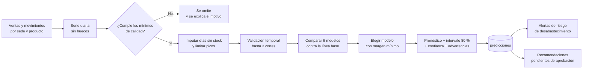

# Predicción de demanda y recomendaciones

Este documento explica cómo Inventia estima la demanda, cómo decide cuándo **no** hacerlo, cómo mide su propio
error y cómo convierte las estimaciones en recomendaciones que una persona debe aprobar. Cubre RF-025 a RF-030
y RNF-021, RNF-029 a RNF-034.

Código: `backend/app/ml/` (cálculo puro, sin base de datos), `backend/app/services/prediccion_service.py`
(orquestación y persistencia) y `backend/app/services/recomendaciones_service.py` (reglas de reposición).

## Principios

1. **Una estimación no es una venta.** Las predicciones se guardan en tablas aparte y la interfaz las rotula
   siempre como estimaciones; nunca se mezclan con ventas reales.
2. **Sin datos suficientes no hay número.** Si una serie no cumple los mínimos de calidad se omite y se informa
   el motivo. El sistema no inventa un pronóstico para llenar una pantalla.
3. **Un modelo complejo debe ganarse su lugar.** Todo modelo avanzado compite contra una línea base simple
   (promedio de 28 días) y solo se usa si la supera por un margen medido en datos que no vio al entrenar.
4. **Toda cifra tiene su error al lado.** Cada predicción lleva WAPE, MAE, intervalo de 80 % y un nivel de
   confianza (alta, media o baja).
5. **Las personas deciden.** Las recomendaciones no mueven inventario ni emiten compras (RNF-034).

## Flujo de una ejecución



La ejecución se solicita con `POST /api/predicciones/ejecutar` (responde `202` de inmediato) y corre en segundo
plano. La interfaz consulta el estado (`en_cola`, `ejecutando`, `completada`, `fallida`). Solo puede haber una
ejecución activa por empresa; las que quedaron «colgadas» por un reinicio del servidor se cierran al arrancar.

## 1. Preparación de los datos (RF-025)

`app/ml/datos.py` construye, para cada par sede-producto activo, la serie de **unidades vendidas por día** desde
su primer movimiento de inventario (o desde el inicio de la ventana de historia, lo que ocurra después) hasta el
último día completo, con ceros en los días sin ventas.

- Solo cuentan las ventas **registradas**: las anuladas no. Las salidas por pérdida, consumo interno, devolución
  al proveedor o traslado no son demanda.
- Se usa el día **local** de la empresa (`APP_TIMEZONE`, por defecto `America/Bogota`), no el día UTC.
- La ventana máxima de historia es `ML_HISTORIA_MAXIMA_DIAS` (365 por defecto).
- El día en curso no se incluye, porque aún está incompleto: la fecha de corte es **ayer**.
- Se marca cada día en que el producto estuvo **sin existencias** (saldo cero al abrir y al cerrar el día, y sin
  ventas): ese día la venta pudo ser menor que la demanda real porque no había qué vender.

## 2. Control de calidad (RNF-029)

Una serie se omite, con motivo explícito, cuando:

| Condición | Mensaje que ve el usuario |
|---|---|
| Menos de 28 días de historia | «Historial insuficiente: N días (se requieren al menos 28)» |
| Menos de 5 días con ventas | «Pocas ventas: N días con ventas en M (se requieren al menos 5)» |
| Más de la mitad del historial sin existencias | «Más de la mitad del historial sin existencias: la demanda real no es observable» |

Si la serie pasa, se limpia antes de modelar:

- **Días sin existencias:** se reemplazan por el promedio de los 28 días observables anteriores. Se advierte
  cuántos fueron.
- **Picos extremos:** los valores por encima de Q3 + 3 × IQR (calculado sobre los días con ventas) se limitan a
  ese tope, para no aprender de un pedido atípico. Se advierte cuántos fueron.
- Se agregan advertencias cuando el historial es corto (menos de 56 días) o la demanda es intermitente
  (más del 60 % de los días sin ventas).

## 3. Modelos candidatos (RNF-021)

| Modelo | Tipo | Idea | Cuándo suele ganar |
|---|---|---|---|
| `media_28` | Línea base | Promedio de los últimos 28 días | Demanda estable |
| `media_7` | Simple | Promedio de los últimos 7 días | Cambios recientes de nivel |
| `estacional_7` | Simple | Promedio de los mismos días de la semana en las últimas 4 semanas | Patrón semanal marcado |
| `croston_sba` | Avanzado | Estima por separado el tamaño y el intervalo entre demandas (Croston, corrección Syntetos-Boylan) | Muchos días sin ventas |
| `ets_semanal` | Avanzado | Suavizado exponencial Holt-Winters con tendencia amortiguada y estacionalidad semanal | Tendencia y ciclo semanal |
| `gbr_rezagos` | Avanzado | Gradient boosting sobre rezagos, medias móviles y día de la semana, con pronóstico recursivo | Series largas con estructura compleja |

Los modelos avanzados se rinden cuando no hay datos para ellos: `ets_semanal` exige al menos 28 días y 10 días
con ventas; `gbr_rezagos` exige al menos 90 días en cada ajuste de entrenamiento. Si un modelo no puede ajustarse
a una serie, simplemente no compite en ella.

## 4. Validación temporal (RNF-030)

`app/ml/evaluacion.py` aplica *rolling origin*: se entrena con el pasado, se pronostica el bloque siguiente, se
compara con lo que realmente ocurrió y se repite desplazando el corte.

- Se usan **hasta 3 cortes**, el último pegado al presente; cada bloque dura entre 7 y 14 días (según el
  horizonte). Quedan al menos 21 días de entrenamiento antes del primer corte.
- Nunca se entrena con datos posteriores al corte (hay una prueba que lo verifica:
  `test_la_validacion_nunca_entrena_con_datos_del_futuro`).
- No se usa validación cruzada aleatoria, porque mezclaría futuro y pasado.

**Métricas**

| Métrica | Fórmula | Lectura |
|---|---|---|
| WAPE | Σ\|pronóstico − real\| / Σ real | Error relativo al volumen. 0,25 = «en promedio nos equivocamos un 25 % de lo vendido». Es la métrica de comparación. |
| MAE | Σ\|pronóstico − real\| / días validados | Error medio en unidades por día. Se usa cuando en la validación no hubo ventas y el WAPE no existe. |
| Sesgo | Σ(pronóstico − real) / Σ real | Positivo: tiende a sobrestimar. Negativo: tiende a subestimar. |

El WAPE global de una ejecución pondera cada serie por su volumen (suma de errores sobre suma de ventas), de
modo que una serie pequeña y ruidosa no distorsiona el resultado.

## 5. Selección del modelo

1. Se elige el mejor modelo **simple** (incluida la línea base) por menor error de validación.
2. Se elige el mejor modelo **avanzado**.
3. El avanzado reemplaza al simple solo si su error es **al menos 3 % menor** (`MEJORA_MINIMA_AVANZADO`).
   De lo contrario se conserva el simple: se prefiere la explicación sencilla cuando la compleja no demuestra
   ventaja.
4. Si el modelo elegido falla al ajustarse con todo el historial, se vuelve a la línea base y se advierte.

La mejora frente a la línea base se informa tanto por serie (`mejora_vs_linea_base_pct`) como de forma global.
Puede ser cero o negativa en una ejecución concreta; el sistema lo muestra tal cual.

## 6. Intervalo y confianza

- **Intervalo de 80 %:** `total ± 1,2816 · σ · √h`, donde σ es la desviación de los errores diarios de validación
  y h el horizonte en días. Es una aproximación: supone errores independientes y de distribución simétrica.
  No debe leerse como garantía.
- **Confianza:**

  | Nivel | Condición |
  |---|---|
  | Alta | WAPE ≤ 0,35, al menos 56 días de historia, al menos 20 días con ventas y 2 o más cortes de validación |
  | Media | WAPE ≤ 0,70 y al menos 10 días con ventas |
  | Baja | Todo lo demás, o si no hay WAPE calculable |

  Una estimación de confianza baja **no** genera alertas ni recomendaciones de prioridad crítica o alta: se limita
  a prioridad media y se rotula «estimación de baja confianza».

## 7. Tiempo y volumen (RNF-012)

- `ML_TIEMPO_MAXIMO_SEGUNDOS` (900 por defecto): si se agota, las series restantes solo comparan modelos simples
  (más rápidos) y la ejecución lo advierte, en vez de abortar.
- `ML_MAX_SERIES_POR_EJECUCION` (5 000 por defecto): tope de series por ejecución.
- El cálculo comparte el proceso de la API. Para catálogos grandes, programe `python -m app.cli predecir` fuera
  del horario de operación (ver [DESPLIEGUE.md](DESPLIEGUE.md)).

## 8. Alertas de riesgo de desabastecimiento

Con una predicción vigente (de menos de 14 días), `alertas_service` calcula la **cobertura** de cada producto:
existencias ÷ demanda diaria prevista.

| Cobertura frente al plazo de entrega | Prioridad |
|---|---|
| Menor que el plazo de entrega | Crítica |
| Menor que plazo + días de seguridad | Alta |
| Menor que el umbral de alerta configurado | Media |

La alerta se abre y se cierra sola cuando cambian las existencias o llega una predicción nueva.

## 9. Recomendaciones (RF-028, RF-029, RNF-033)

Las reglas son explícitas y sus parámetros los configura cada empresa (pantalla **Empresa → Parámetros**):

| Parámetro | Por defecto | Significado |
|---|---|---|
| `plazo_entrega_dias` | 7 | Días entre pedir y recibir mercancía |
| `dias_seguridad` | 3 | Colchón adicional sobre el plazo |
| `dias_cobertura_objetivo` | 21 | Días de demanda que se quiere cubrir al reabastecer |
| `horizonte_dias` | 14 | Horizonte por defecto de la predicción |
| `umbral_cobertura_alerta_dias` | 5 | Cobertura bajo la cual se alerta |
| `dias_sin_rotacion` | 60 | Días sin movimiento con existencias para pedir revisión |
| `dias_max_anulacion` | 30 | Plazo para anular una venta |

Con `d` = demanda diaria prevista:

```
punto_reposicion = máx( d · (plazo_entrega + días_seguridad) , stock_mínimo )
nivel_objetivo   = d · (plazo_entrega + días_seguridad + días_cobertura_objetivo)   (sin pasar del stock máximo)
```

- Se **recomienda reabastecer** cuando `existencias + en camino ≤ punto_reposicion`, por la cantidad
  `nivel_objetivo − (existencias + en camino)`.
- Antes de pedir, si otra sede tiene **excedente** (existencias por encima de lo que necesita para cubrir su propio
  nivel objetivo, o por encima de su stock máximo), se sugiere un **traslado** desde esa sede. Solo lo que no se
  pueda cubrir así se sugiere como compra.
- «En camino» incluye los traslados solicitados o aprobados que aún no se confirmaron, para no recomendar dos
  veces lo mismo.
- Cada recomendación guarda en `justificacion` los datos que la originan (demanda diaria, cobertura, plazos,
  modelo, confianza) y un texto en español que los resume.

**Ciclo de vida.** `pendiente → aprobada → ejecutada`, o `pendiente → rechazada`. Al volver a generar,
las pendientes anteriores pasan a `reemplazada` (se conserva el historial) y una aprobada no se duplica.

- Aprobar una recomendación de **traslado** crea una *solicitud* de traslado. Esa solicitud todavía debe ser
  aprobada por la sede de origen y confirmada por la de destino: aprobar una recomendación no mueve existencias.
- Aprobar una de **reabastecimiento** solo registra la decisión; «marcar como ejecutada» deja constancia de que la
  compra se hizo fuera del sistema. Inventia no emite órdenes de compra.

## 10. Cómo repetir la evaluación

`ml/evaluar_modelos.py` es un experimento reproducible: genera series **sintéticas** de cinco comportamientos
(estable, estacional, con tendencia, intermitente y ruidosa) y las evalúa con la misma validación temporal que usa
el sistema. Muestra el WAPE de cada modelo por tipo de serie y en cuántas series cada modelo supera a la línea base
por el margen exigido. Sirve para comprobar que cada modelo hace lo que promete (por ejemplo, que el estacional
gane en series estacionales y que ningún modelo «invente» mejoras donde no las hay).

```bash
cd backend
python ../ml/evaluar_modelos.py --series 40 --dias 120 --horizonte 14 --semilla 7
```

No toca la base de datos. Con datos reales, el módulo de predicción del sistema aplica el mismo procedimiento
sobre el historial de ventas de la empresa y deja las métricas guardadas en cada predicción. Detalles en
[`ml/README.md`](../ml/README.md).

## Limitaciones conocidas

- **Solo mira ventas pasadas.** No conoce promociones, festivos, cambios de precio, clima ni la llegada de
  competidores. Si el negocio cambia de forma abrupta, la estimación tardará varias semanas en reflejarlo.
- **Productos nuevos:** con menos de 28 días de historia no hay pronóstico (por diseño).
- **Demanda censurada:** la imputación de días sin existencias es una aproximación. Si un producto estuvo agotado
  gran parte del tiempo, la demanda real queda subestimada y el sistema lo advierte o lo omite.
- **Intervalo aproximado:** supone errores independientes; en series con rachas puede ser demasiado optimista.
- **Evaluación sobre datos de demostración:** las cifras de precisión que se obtienen con `cargar-demo` provienen
  de datos **sintéticos** y no deben presentarse como el desempeño esperado en una empresa real. El desempeño
  real solo se conoce al medirlo sobre las ventas del cliente, y para eso existe la validación temporal.
- **Una sola unidad de medida por producto:** no se convierten unidades (cajas ↔ unidades).
- **Sin variables externas ni jerarquías:** no se agrupa por categoría ni se comparten patrones entre sedes.
