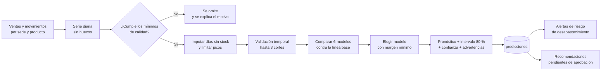

# Predicción de demanda y recomendaciones

Este documento explica cómo Inventia estima la demanda, cómo decide cuándo **no** hacerlo, cómo mide su propio
error y cómo convierte las estimaciones en recomendaciones que una persona debe aprobar. Cubre RF-025 a RF-030
y RNF-021, RNF-029 a RNF-034.

Código: `backend/app/ml/` (cálculo puro, sin base de datos), `backend/app/service/prediccion_service.py`
(orquestación y persistencia) y `backend/app/service/recomendaciones_service.py` (reglas de reposición).

## Principios

1. **Una estimación no es una venta.** Las predicciones se guardan en tablas aparte y la interfaz las rotula
   siempre como estimaciones; nunca se mezclan con ventas reales.
2. **Sin datos suficientes no hay número.** Si una serie no cumple los mínimos de calidad se omite y se informa
   el motivo. El sistema no inventa un pronóstico para llenar una pantalla.
3. **Un modelo complejo debe ganarse su lugar.** Todo modelo avanzado compite contra una línea base simple
   (promedio de 28 días) y solo se usa si la supera por un margen medido en datos que no vio al entrenar.
4. **Toda cifra tiene su error al lado.** Cada predicción lleva WAPE, MAE, RMSE, MAPE, intervalo de 80 % y un nivel de
   confianza (alta, media o baja).
5. **Las personas deciden.** Las recomendaciones no mueven inventario ni emiten compras (RNF-034).

## Flujo de una ejecución



La ejecución se solicita con `POST /api/predicciones/ejecutar` (responde `202` de inmediato) y corre en segundo
plano. La interfaz consulta el estado (`en_cola`, `ejecutando`, `completada`, `fallida`). Solo puede haber una
ejecución activa por empresa; las que quedaron «colgadas» por un reinicio del servidor se cierran al arrancar.

## 1. Preparación de los datos (RF-025)

`app/ml/datos.py` construye, para cada par sede-producto activo, la serie de **unidades vendidas por día** desde
su primer movimiento de inventario (o desde el inicio de la ventana de historia, lo que ocurra después) hasta el
último día completo, con ceros en los días sin ventas.

- Solo cuentan las ventas **registradas**: las anuladas no. Las salidas por pérdida, consumo interno, devolución
  al proveedor o traslado no son demanda.
- Se usa el día **local** de la empresa (`APP_TIMEZONE`, por defecto `America/Bogota`), no el día UTC.
- La ventana máxima de historia es `ML_HISTORIA_MAXIMA_DIAS` (365 por defecto).
- El día en curso no se incluye, porque aún está incompleto: la fecha de corte es **ayer**.
- Se marca cada día en que el producto estuvo **sin existencias** (saldo cero al abrir y al cerrar el día, y sin
  ventas): ese día la venta pudo ser menor que la demanda real porque no había qué vender.

## 2. Control de calidad (RNF-029)

Una serie se omite, con motivo explícito, cuando:

| Condición | Mensaje que ve el usuario |
|---|---|
| Menos de 28 días de historia | «Historial insuficiente: N días (se requieren al menos 28)» |
| Menos de 5 días con ventas | «Pocas ventas: N días con ventas en M (se requieren al menos 5)» |
| Más de la mitad del historial sin existencias | «Más de la mitad del historial sin existencias: la demanda real no es observable» |

Si la serie pasa, se limpia antes de modelar:

- **Días sin existencias:** se reemplazan por el promedio de los 28 días observables anteriores. Se advierte
  cuántos fueron.
- **Picos extremos:** los valores por encima de Q3 + 3 × IQR (calculado sobre los días con ventas) se limitan a
  ese tope, para no aprender de un pedido atípico. Se advierte cuántos fueron.
- Se agregan advertencias cuando el historial es corto (menos de 56 días) o la demanda es intermitente
  (más del 60 % de los días sin ventas).

## 3. Modelos candidatos (RNF-021)

| Modelo | Tipo | Idea | Cuándo suele ganar |
|---|---|---|---|
| `media_28` | Línea base | Promedio de los últimos 28 días | Demanda estable |
| `media_7` | Simple | Promedio de los últimos 7 días | Cambios recientes de nivel |
| `estacional_7` | Simple | Promedio de los mismos días de la semana en las últimas 4 semanas | Patrón semanal marcado |
| `croston_sba` | Avanzado | Estima por separado el tamaño y el intervalo entre demandas (Croston, corrección Syntetos-Boylan) | Muchos días sin ventas |
| `ets_semanal` | Avanzado | Suavizado exponencial Holt-Winters con tendencia amortiguada y estacionalidad semanal | Tendencia y ciclo semanal |
| `gbr_rezagos` | Avanzado | Gradient boosting sobre rezagos, medias móviles y día de la semana, con pronóstico recursivo | Series largas con estructura compleja |

Los modelos avanzados se rinden cuando no hay datos para ellos: `ets_semanal` exige al menos 28 días y 10 días
con ventas; `gbr_rezagos` exige al menos 90 días en cada ajuste de entrenamiento. Si un modelo no puede ajustarse
a una serie, simplemente no compite en ella.

## 4. Validación temporal (RNF-030)

`app/ml/evaluacion.py` aplica *rolling origin*: se entrena con el pasado, se pronostica el bloque siguiente, se
compara con lo que realmente ocurrió y se repite desplazando el corte.

- Se usan **hasta 3 cortes**, el último pegado al presente; cada bloque dura entre 7 y 14 días (según el
  horizonte). Quedan al menos 21 días de entrenamiento antes del primer corte.
- Nunca se entrena con datos posteriores al corte (hay una prueba que lo verifica:
  `test_la_validacion_nunca_entrena_con_datos_del_futuro`).
- No se usa validación cruzada aleatoria, porque mezclaría futuro y pasado.

**Métricas**

| Métrica | Fórmula | Lectura |
|---|---|---|
| WAPE | Σ\|pronóstico − real\| / Σ real | Error relativo al volumen. 0,25 = «en promedio nos equivocamos un 25 % de lo vendido». Es la métrica de comparación. |
| MAE | Σ\|pronóstico − real\| / días validados | Error medio en unidades por día. Se usa cuando en la validación no hubo ventas y el WAPE no existe. |
| RMSE | √( Σ(pronóstico − real)² / días validados ) | Error típico en unidades por día. Castiga más los errores grandes que el MAE, así que siempre es mayor o igual que él; si la distancia entre ambos crece, hay fallos puntuales grandes. |
| MAPE | Σ( \|pronóstico − real\| / real ) / días con ventas | Error porcentual medio. **Solo se calcula sobre los días con ventas**, porque con venta cero el cociente no existe. Se informa como complemento; no decide qué modelo se elige. |
| Sesgo | Σ(pronóstico − real) / Σ real | Positivo: tiende a sobrestimar. Negativo: tiende a subestimar. |

**Por qué el WAPE decide y el MAPE solo acompaña.** El MAPE se usa mucho, pero no está definido cuando la venta del
día es cero (algo habitual en una sede con productos de baja rotación) y se dispara cuando la venta es pequeña: un
error de 1 unidad sobre una venta de 1 pesa lo mismo que 100 sobre 100. El WAPE evita ambos problemas porque divide
la suma de los errores entre la suma de las ventas. Por eso el sistema elige con WAPE y muestra el MAPE (solo con
días con ventas) y el RMSE para que se puedan comparar con otros trabajos. Si en la validación no hubo ventas,
el WAPE y el MAPE no existen y se muestran como «—»; el MAE y el RMSE sí.

El WAPE global de una ejecución pondera cada serie por su volumen (suma de errores sobre suma de ventas), de
modo que una serie pequeña y ruidosa no distorsiona el resultado. El RMSE global y el MAPE global se calculan igual:
con las sumas de todas las series (no con el promedio de los promedios), y la ejecución también guarda los de la línea base.

## 5. Selección del modelo

1. Se elige el mejor modelo **simple** (incluida la línea base) por menor error de validación.
2. Se elige el mejor modelo **avanzado**.
3. El avanzado reemplaza al simple solo si su error es **al menos 3 % menor** (`MEJORA_MINIMA_AVANZADO`).
   De lo contrario se conserva el simple: se prefiere la explicación sencilla cuando la compleja no demuestra
   ventaja.
4. Si el modelo elegido falla al ajustarse con todo el historial, se vuelve a la línea base y se advierte.

La mejora frente a la línea base se informa tanto por serie (`mejora_vs_linea_base_pct`) como de forma global.
Puede ser cero o negativa en una ejecución concreta; el sistema lo muestra tal cual.

## 6. Intervalo y confianza

- **Intervalo de 80 %:** `total ± 1,2816 · 0,8 · σ · h^0,75`, donde σ es la desviación de los errores diarios de
  validación y h el horizonte en días. La fórmula clásica `σ · √h` supone errores independientes de un día a otro,
  pero un error de nivel se repite todos los días, así que se queda corta para el total del período: en las pruebas
  fuera de muestra (§11) cubrió solo 62 % de los casos con h = 14. La escala (0,8) y el exponente (0,75) se
  calibraron con esas pruebas y llevan la cobertura medida a 78–83 % para horizontes de 7 a 28 días. Se calibraron con
  datos **sintéticos**: con datos reales debe volver a medirse la cobertura (`ml/evaluar_fuera_de_muestra.py`) y, si
  difiere, ajustar `ESCALA_INTERVALO` y `EXPONENTE_HORIZONTE_INTERVALO` en `app/ml/pipeline.py`. No debe leerse como
  garantía; con horizontes mayores de 28 días es una extrapolación.
- **Confianza:**

  | Nivel | Condición |
  |---|---|
  | Alta | WAPE ≤ 0,35, al menos 56 días de historia, al menos 20 días con ventas y 2 o más cortes de validación |
  | Media | WAPE ≤ 0,70 y al menos 10 días con ventas |
  | Baja | Todo lo demás, o si no hay WAPE calculable |

  Una estimación de confianza baja **no** genera alertas ni recomendaciones de prioridad crítica o alta: se limita
  a prioridad media y se rotula «estimación de baja confianza».

## 7. Tiempo y volumen (RNF-012)

- `ML_TIEMPO_MAXIMO_SEGUNDOS` (900 por defecto): si se agota, las series restantes solo comparan modelos simples
  (más rápidos) y la ejecución lo advierte, en vez de abortar.
- `ML_MAX_SERIES_POR_EJECUCION` (5 000 por defecto): tope de series por ejecución.
- El cálculo comparte el proceso de la API. Para catálogos grandes, programe `python -m app.cli predecir` fuera
  del horario de operación (ver [DESPLIEGUE.md](DESPLIEGUE.md)).
- **Duración medida** (equipo de 2 núcleos, datos sintéticos de la demostración, 108 series con 200 días de historia): unos
  55 s sin otros usuarios y 62 s con 20 personas consultando a la vez; mientras corre, la mediana de las consultas pasó de
  16 a 71 ms y el p95 de 54 a 380 ms, sin errores. Con una base 50 veces mayor (el historial usado sigue limitado a 200 días)
  tardó 76 s. Detalle en [RENDIMIENTO.md](RENDIMIENTO.md).

## 8. Alertas de riesgo de desabastecimiento

Con una predicción vigente (de menos de 14 días), `alertas_service` calcula la **cobertura** de cada producto:
existencias ÷ demanda diaria prevista.

| Cobertura frente al plazo de entrega | Prioridad |
|---|---|
| Menor que el plazo de entrega | Crítica |
| Menor que plazo + días de seguridad | Alta |
| Menor que el umbral de alerta configurado | Media |

La alerta se abre y se cierra sola cuando cambian las existencias o llega una predicción nueva.

## 9. Recomendaciones (RF-028, RF-029, RNF-033)

Las reglas son explícitas y sus parámetros los configura cada empresa (pantalla **Empresa → Parámetros**):

| Parámetro | Por defecto | Significado |
|---|---|---|
| `plazo_entrega_dias` | 7 | Días entre pedir y recibir mercancía |
| `dias_seguridad` | 3 | Colchón adicional sobre el plazo |
| `dias_cobertura_objetivo` | 21 | Días de demanda que se quiere cubrir al reabastecer |
| `horizonte_dias` | 14 | Horizonte por defecto de la predicción |
| `umbral_cobertura_alerta_dias` | 5 | Cobertura bajo la cual se alerta |
| `dias_sin_rotacion` | 60 | Días sin movimiento con existencias para pedir revisión |
| `dias_max_anulacion` | 30 | Plazo para anular una venta |

Con `d` = demanda diaria prevista:

```
punto_reposicion = máx( d · (plazo_entrega + días_seguridad) , stock_mínimo )
nivel_objetivo   = d · (plazo_entrega + días_seguridad + días_cobertura_objetivo)   (sin pasar del stock máximo)
```

- Se **recomienda reabastecer** cuando `existencias + en camino ≤ punto_reposicion`, por la cantidad
  `nivel_objetivo − (existencias + en camino)`.
- Antes de pedir, si otra sede tiene **excedente** (existencias por encima de lo que necesita para cubrir su propio
  nivel objetivo, o por encima de su stock máximo), se sugiere un **traslado** desde esa sede. Solo lo que no se
  pueda cubrir así se sugiere como compra.
- «En camino» incluye los traslados solicitados o aprobados que aún no se confirmaron, para no recomendar dos
  veces lo mismo.
- Cada recomendación guarda en `justificacion` los datos que la originan (demanda diaria, cobertura, plazos,
  modelo, confianza) y un texto en español que los resume.

**Ciclo de vida.** `pendiente → aprobada → ejecutada`, o `pendiente → rechazada`. Al volver a generar,
las pendientes anteriores pasan a `reemplazada` (se conserva el historial) y una aprobada no se duplica.

- Aprobar una recomendación de **traslado** crea una *solicitud* de traslado. Esa solicitud todavía debe ser
  aprobada por la sede de origen y confirmada por la de destino: aprobar una recomendación no mueve existencias.
- Aprobar una de **reabastecimiento** solo registra la decisión; «marcar como ejecutada» deja constancia de que la
  compra se hizo fuera del sistema. Inventia no emite órdenes de compra.

## 10. Cómo repetir la evaluación

`ml/evaluar_modelos.py` es un experimento reproducible: genera series **sintéticas** de cinco comportamientos
(estable, estacional, con tendencia, intermitente y ruidosa) y las evalúa con la misma validación temporal que usa
el sistema. Muestra el WAPE de cada modelo por tipo de serie y en cuántas series cada modelo supera a la línea base
por el margen exigido. Sirve para comprobar que cada modelo hace lo que promete (por ejemplo, que el estacional
gane en series estacionales y que ningún modelo «invente» mejoras donde no las hay).

```bash
cd backend
python ../ml/evaluar_modelos.py --series 40 --dias 120 --horizonte 14 --semilla 7
```

Para medir sobre las ventas de una base de datos (la de demostración, por ejemplo) está
`ml/evaluar_fuera_de_muestra.py`, que oculta los últimos días de cada serie, deja que el sistema elija y pronostique
con el resto y compara con lo que realmente pasó (§11). Solo lee la base de datos.

```bash
cd backend
python ../ml/evaluar_fuera_de_muestra.py --salida ../ml/resultados --horizonte 14 --ventanas 3
```

`evaluar_modelos.py` no toca la base de datos. Con datos reales, el módulo de predicción del sistema aplica el mismo procedimiento
sobre el historial de ventas de la empresa y deja las métricas guardadas en cada predicción. Detalles en
[`ml/README.md`](../ml/README.md).

## 11. Resultados con datos de demostración (RNF-030)

**Importante.** Todo lo que sigue se midió sobre la base de demostración (`cargar-demo`): una empresa **ficticia** de
movilidad eléctrica con 3 sedes, 36 productos y 200 días de ventas generadas por un simulador (5.194 ventas, 34.314
unidades, del 9 de abril al 25 de octubre de 2026). Son datos sintéticos con estacionalidad semanal y ruido de Poisson
que el propio proyecto define; sirven para verificar que el procedimiento funciona y para dimensionar el efecto, **no**
para prometer una precisión en una empresa real. La demanda por serie es en su mayoría de pocas unidades por día
(mediana: 30,5 % de los días sin venta), lo que hace que el error porcentual sea alto en todos los modelos.

### 11.1 Cómo es la demanda (análisis exploratorio)

| Hallazgo | Valor |
|---|---|
| Unidades por día (empresa) | media 171,6 · mediana 177 · mín. 97 · máx. 227 |
| Día de la semana (índice, promedio = 1) | lun 1,04 · mar 0,98 · mié 0,99 · jue 1,05 · vie 1,15 · sáb 1,11 · dom 0,69 |
| Clasificación ABC por valor vendido | A: 13 productos (36 %) = 81,5 % del valor · B: 11 (31 %) = 13,8 % · C: 12 (33 %) = 4,7 % |
| Patrón de demanda por serie (Syntetos–Boylan–Croston; ADI = 1,32 y CV² = 0,49) | 39 suaves · 67 intermitentes · 0 erráticas · 1 irregular (107 series) |
| Series con más de 60 % de días sin venta | 32 de 107 |

### 11.2 Validación interna: los seis modelos frente a la línea base

Es el cálculo que hace el sistema en cada ejecución (origen móvil, hasta 3 cortes, horizonte 14 días), acumulado sobre
las series evaluables. Cada columna se calcula con **sumas** sobre todas las series (no promedio de razones):
WAPE = Σ|e| / Σ real; MAE = Σ|e| / días; RMSE = √(Σe² / días); MAPE = promedio de |e|/real solo en días con ventas.

| Modelo | Series | WAPE | MAE | RMSE | MAPE | Sesgo | Series en que es el mejor |
|---|---|---|---|---|---|---|---|
| Suavizado exponencial semanal (`ets_semanal`) | 102 | 51,2 % | 0,948 | 1,388 | 51,8 % | −1,0 % | 45 |
| Gradient boosting sobre rezagos (`gbr_rezagos`) | 104 | 54,5 % | 0,991 | 1,471 | 56,5 % | −0,8 % | 20 |
| **Promedio de 28 días (línea base)** | 104 | 54,9 % | 0,998 | 1,508 | 54,7 % | −0,4 % | 9 |
| Croston–SBA (`croston_sba`) | 104 | 54,9 % | 0,998 | 1,516 | 53,4 % | −4,7 % | 7 |
| Perfil semanal de 4 semanas (`estacional_7`) | 104 | 56,7 % | 1,030 | 1,529 | 58,7 % | −0,4 % | 10 |
| Promedio de 7 días (`media_7`) | 104 | 56,7 % | 1,031 | 1,547 | 58,0 % | +0,6 % | 13 |

El sistema elige por serie y con la regla del 3 %: eligió `ets_semanal` en 36 series, `gbr_rezagos` en 18, `media_7` en
17, `media_28` en 16, `estacional_7` en 12 y `croston_sba` en 5 (104 series; 4 se omitieron por historial o ventas
insuficientes). Con esa selección el WAPE global es **50,1 % frente a 54,9 %** de la línea base y el RMSE 1,385 frente a
1,508; mejora en 88 series, empata en 16 y no empeora ninguna.

**Esa mejora está inflada.** La validación interna también se usa para elegir el modelo, así que el modelo elegido tiene
la ventaja de haberse escogido justamente por ganar en esas ventanas (sesgo de selección). Por eso se hizo la prueba de §11.3.

### 11.3 Prueba fuera de muestra (holdout)

`ml/evaluar_fuera_de_muestra.py` oculta los últimos *h* días de cada serie (ni se entrenan ni se usan para elegir), deja
que el sistema complete su proceso con el resto y compara su pronóstico con lo que pasó; lo repite en *N* ventanas
consecutivas hacia atrás. La línea base se entrena con los mismos datos. Cada fila agrupa todas las series y ventanas.

| Horizonte (ventanas) | Series-ventana | WAPE sistema | WAPE línea base | Diferencia (IC 95 %) | RMSE sistema / base | MAPE sistema / base | Mejora / igual / empeora |
|---|---|---|---|---|---|---|---|
| 7 días (4) | 416 | 66,5 % | 69,5 % | −2,95 pts (−4,30 a −1,62) | 1,776 / 1,846 | 55,7 % / 56,6 % | 215 / 45 / 156 |
| 14 días (3) | 311 | 68,3 % | 69,6 % | −1,38 pts (−2,54 a −0,24) | 1,808 / 1,836 | 57,6 % / 57,4 % | 151 / 23 / 137 |
| 28 días (2) | 207 | 67,3 % | 69,5 % | −2,23 pts (−3,35 a −1,08) | 1,777 / 1,837 | 56,9 % / 56,6 % | 109 / 12 / 86 |

El intervalo de confianza de la diferencia es un remuestreo (5.000 repeticiones) de las series-ventana; las ventanas se
solapan en el tiempo y las series de un mismo producto están correlacionadas, así que el intervalo es optimista.

**Lectura honesta:**

- Fuera de muestra, el sistema reduce el error absoluto total frente al promedio de 28 días en **2 a 4 % (relativo)**:
  una mejora real pero pequeña, mucho menor que el 9 % que sugiere la validación interna. Con estos datos la ganancia
  de los modelos avanzados es modesta; el valor del sistema está más en medir, comparar y no elegir modelos peores que
  la línea base que en un salto de precisión.
- Entre 37,5 % y 44,1 % de las series-ventana el modelo elegido fue peor que la línea base. La regla del 3 % reduce, pero no elimina,
  elegir mal por azar de la validación. El MAPE prácticamente no cambia.
- El sesgo medio es de +8 % a +9 % (el pronóstico tiende a sobrestimar la demanda total), igual que el de la línea base.
- La demanda de estas series (pocas unidades por día, Poisson) impone un piso de error que ningún modelo puede bajar:
  con media de 1–2 unidades por día, un WAPE de 60 % no es un fallo del método sino ruido irreducible.

### 11.4 Cobertura del intervalo de 80 %

Fracción de series-ventana en las que la demanda real del período cayó dentro del intervalo mostrado:

| Horizonte | Con `σ·√h` (sin calibrar, medido con h = 14) | Con la fórmula calibrada (versión actual) |
|---|---|---|
| 7 días | — | 79,1 % |
| 14 días | 62,4 % | 82,6 % |
| 28 días | — | 77,8 % |

El hallazgo de la cobertura de 62 % llevó a cambiar la fórmula (§6). La calibración usa las mismas series con que se
midió, por lo que la cobertura real en datos nuevos puede ser algo menor: es una verificación de consistencia, no una
garantía.

## 12. Validación de las recomendaciones por simulación (RF-028, RF-029)

Las secciones anteriores miden el pronóstico. Esta responde otra pregunta: **¿habrían sido menores los quiebres de stock si la
empresa hubiera seguido las recomendaciones?** No se puede contestar con una prueba unitaria; se «repite» un período reciente
con `ml/simular_recomendaciones.py`, que usa la demanda que realmente ocurrió en la base y compara cuatro políticas de reposición
sobre las mismas 105 series (sede × producto, de las que 103 tienen pronóstico). Las reglas de C y D son las del servicio real
(`recomendaciones_service._calcular`), no una copia; el pronóstico de cada semana usa solo las ventas anteriores a ese día.

| Política | Qué hace |
|---|---|
| **A** Sin reposición | No se pide nada. Es un punto de referencia, no una alternativa realista |
| **B** Mínimos y máximos fijos | Se pide hasta el máximo configurado cuando las existencias (más lo que viene en camino) bajan del mínimo. Los niveles no se adaptan a la demanda |
| **C** Reglas de Inventia con promedio de 28 días | Las reglas del módulo (punto de reposición, nivel objetivo, traslados antes que compras) con la demanda estimada como promedio de 28 días |
| **D** Inventia completo | Las mismas reglas con el pronóstico que elige el pipeline |

**Montaje.** Últimas 8 semanas (56 días) de la base de demostración; las existencias iniciales son las que había al comenzar;
se revisa una vez por semana; los pedidos llegan al cumplirse el plazo de entrega (7 días) y los traslados a los 2 días;
parámetros de la empresa por defecto (seguridad 3 días, cobertura objetivo 21 días). Una sola corrida es determinista.

| Política | Nivel de servicio | Unidades perdidas | Días-serie con quiebre | Inventario promedio (unidades) | Días de inventario | Compras | Traslados |
|---|---:|---:|---:|---:|---:|---:|---:|
| A Sin reposición | 26,1 % | 7.173 | 42,0 % | 609 | 3,5 | 0 | 0 |
| B Mínimos y máximos fijos | 88,6 % | 1.107 | 7,3 % | 3.716 | 21,4 | 118 | 0 |
| C Reglas con promedio de 28 días | 93,8 % | 606 | 3,7 % | 2.557 | 14,8 | 220 | 29 |
| D Inventia completo | 93,8 % | 602 | 3,6 % | 2.599 | 15,0 | 212 | 9 |

La demanda total de la ventana fue de 9.708 unidades. El «nivel de servicio» es la fracción de la demanda atendida; la venta que
no se puede atender se da por perdida.

**Diferencia de ventas perdidas (puntos porcentuales de la demanda; intervalo de 95 % por remuestreo de las 105 series):**

| Comparación | Diferencia | IC 95 % |
|---|---:|---|
| A − D | 67,7 pts | 61,9 a 72,6 |
| B − D | **5,2 pts** | 3,4 a 7,0 |
| C − D | 0,0 pts | −0,9 a 1,0 |

**Si las sugerencias no se aceptan todas.** Cada sugerencia se acepta o se descarta al azar; las descartadas no se vuelven a
considerar hasta la siguiente revisión. Se repitió 30 veces por nivel y política (con la misma semilla):

| Aceptación | B | C | D |
|---|---|---|---|
| 100 % | 88,6 % | 93,8 % | 93,8 % |
| 70 % | 83,9 % (81,5 a 86,0) | 86,5 % (82,9 a 90,2) | 86,7 % (83,7 a 89,3) |
| 40 % | 73,0 % (66,8 a 78,8) | 73,5 % (68,4 a 78,6) | 74,2 % (68,4 a 78,8) |

Nivel de servicio medio y, entre paréntesis, el mínimo y el máximo de las 30 repeticiones.

**Lectura honesta:**

- Frente a no hacer nada (A) la diferencia es enorme, pero A es un punto de referencia: en la operación real sí se repone.
- Frente a los mínimos y máximos fijos (B), las reglas de Inventia perdieron 5 puntos menos de la demanda (de 11,4 % a 6,2 %) y lo
  hicieron con **30 % menos inventario** promedio (15 días frente a 21). Es la comparación que importa, y su intervalo no incluye el cero.
- **Esa ventaja viene de las reglas, no del modelo.** C (promedio de 28 días) y D (pronóstico del sistema) dan prácticamente lo
  mismo: la diferencia es 0,0 puntos y su intervalo incluye el cero. Con estos datos el pronóstico avanzado no mejora las
  decisiones respecto de un promedio simple, lo que concuerda con la mejora pequeña de 2 a 4 % medida en §11.3. D sí hace menos
  traslados (9 frente a 29) para un número casi igual de unidades movidas, es decir, traslados más grandes.
- **La ventaja depende de que las recomendaciones se sigan.** Con 70 % de aceptación D queda en 86,7 %, aún por encima de B con
  la misma aceptación (83,9 %), pero los rangos se traslapan; con 40 % las tres políticas son indistinguibles. Una herramienta
  que se ignora no reduce quiebres.
- El resultado se obtuvo con datos **sintéticos** generados con un proceso parecido al que el pronóstico supone (estacionalidad
  semanal y ruido de Poisson). Ilustra el mecanismo; no mide el beneficio que tendría una empresa real.

**Supuestos que condicionan la simulación.** La demanda es la venta observada (si hubo quiebres reales, la demanda verdadera pudo
ser mayor); los pedidos llegan exactamente en el plazo y no hay cantidades mínimas de compra, descuentos, capital ni espacio
limitados; la venta no atendida se pierde; se revisa una vez por semana igual para todas las políticas; los niveles mínimo y máximo
de B son los que trae la base de demostración, que no se ajustaron para favorecer ni perjudicar a ninguna política.

```bash
cd backend
python ../ml/simular_recomendaciones.py --salida ../ml/resultados --ventana 56 --revision 7 --transito 2 --aceptacion 1.0,0.7,0.4
```

Las cifras de esta sección salen de `ml/resultados/simulacion_resumen.json`; el detalle por serie está en `simulacion_series.csv`.

## Limitaciones conocidas

- **Solo mira ventas pasadas.** No conoce promociones, festivos, cambios de precio, clima ni la llegada de
  competidores. Si el negocio cambia de forma abrupta, la estimación tardará varias semanas en reflejarlo.
- **Productos nuevos:** con menos de 28 días de historia no hay pronóstico (por diseño).
- **Demanda censurada:** la imputación de días sin existencias es una aproximación. Si un producto estuvo agotado
  gran parte del tiempo, la demanda real queda subestimada y el sistema lo advierte o lo omite.
- **Intervalo aproximado:** la forma `σ · h^0,75` se calibró con datos sintéticos (§6 y §11.4); puede quedar corto en series con rachas, cambios de nivel o horizontes mayores de 28 días.
- **Evaluación sobre datos de demostración:** las cifras de precisión que se obtienen con `cargar-demo` provienen
  de datos **sintéticos** y no deben presentarse como el desempeño esperado en una empresa real. El desempeño
  real solo se conoce al medirlo sobre las ventas del cliente, y para eso existe la validación temporal.
- **Una sola unidad de medida por producto:** no se convierten unidades (cajas ↔ unidades).
- **Sin variables externas ni jerarquías:** no se agrupa por categoría ni se comparten patrones entre sedes.
